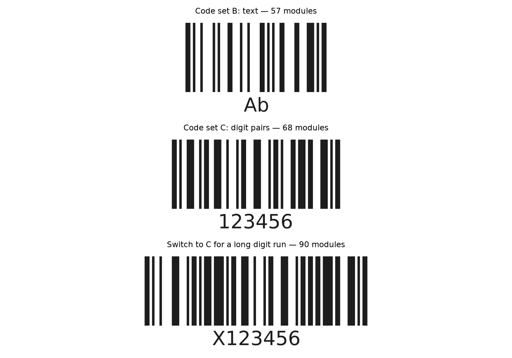

Code 128 encoding.

Long digit runs are packed as pairs in code set C; text uses code set B. The encoder switches at run
boundaries automatically.

## Functions

### `encode()`

```python
encode(text: str) -> barcode.Encoded
```

Encodes printable ASCII as Code 128.

| Parameter | Type              | Description |
| --------- | ----------------- | ----------- |
| `text`    | `str`             |             |
| _Returns_ | `barcode.Encoded` |             |



*Code set B, code set C, and an automatic B-to-C switch*
