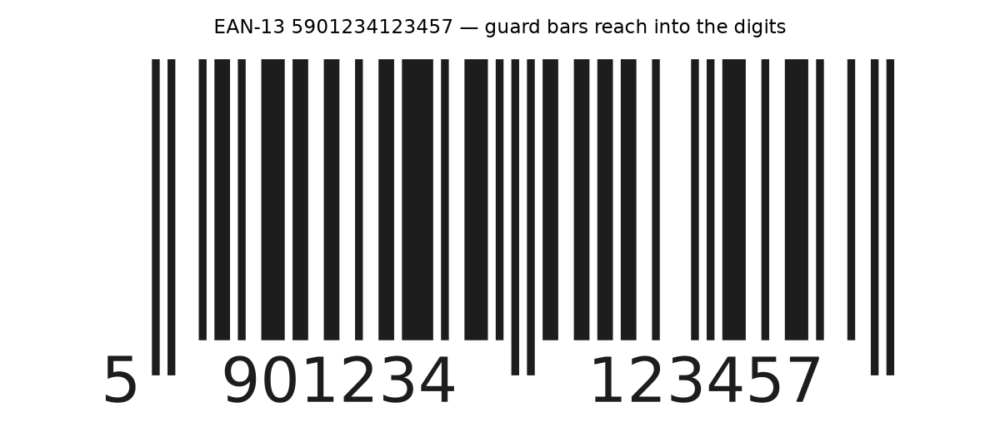

EAN-13 encoding.

Twelve digits get their check digit computed; thirteen digits have the supplied check digit
verified. Guard-bar columns are marked so the geometry layer can extend them into the printed
digits.

## Functions

### `encode()`

```python
encode(text: str) -> barcode.Encoded
```

Encodes 12 or 13 digits as EAN-13.

| Parameter | Type              | Description |
| --------- | ----------------- | ----------- |
| `text`    | `str`             |             |
| _Returns_ | `barcode.Encoded` |             |



*Twelve digits, with the check digit computed and printed*
