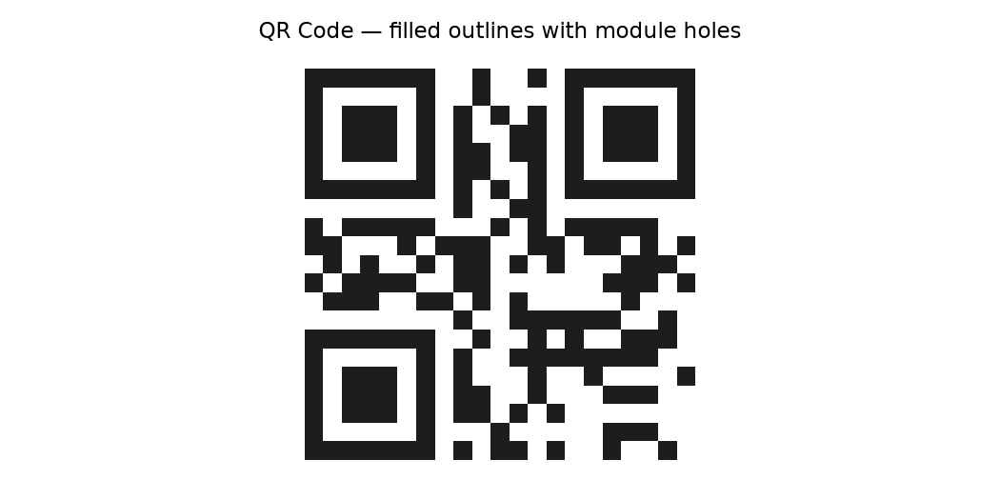
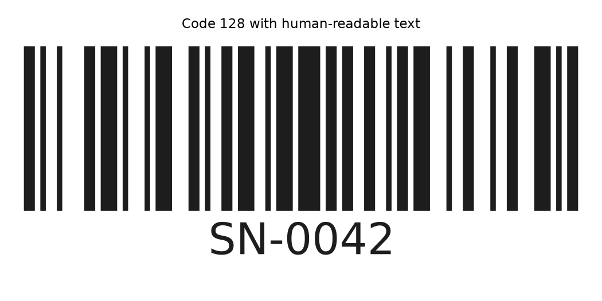
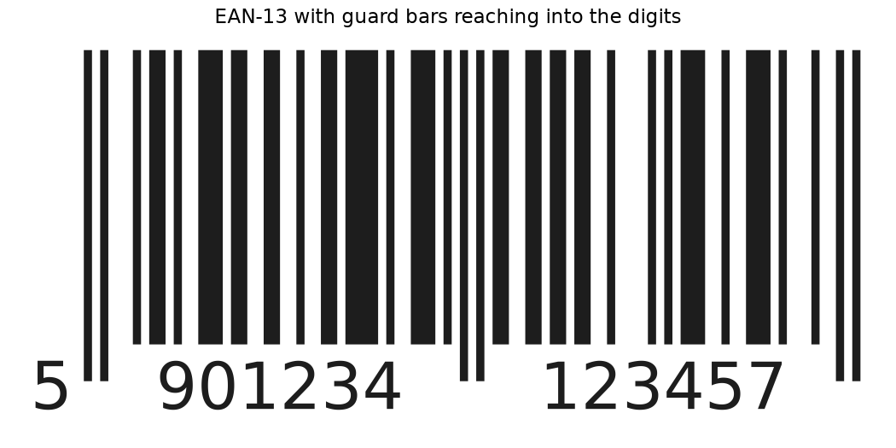
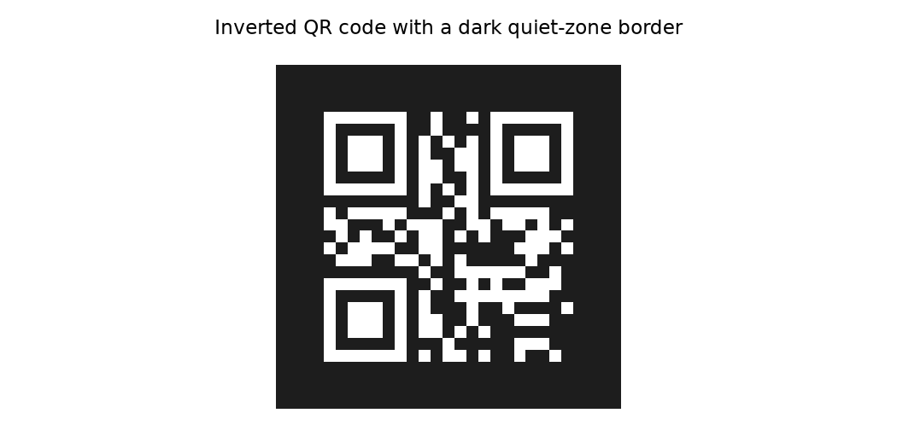

Barcode geometry rendering.

Turns encoded modules into closed outlines in millimetres, merges dark modules into polygons with
holes, adds optional human-readable text and renders the inverted variant. The result is suitable
both as a fill and as a contour.

## BarcodeStyle

How a barcode symbol is drawn.

### `bar_height_mm`

```python
bar_height_mm: float
```

Height of the bars, in millimetres.

### `invert`

```python
invert: bool
```

Whether to draw a light code on a dark quiet-zone border.

### `module_mm`

```python
module_mm: float
```

Width of the narrowest bar, or one QR module, in millimetres.

### `quiet_zone`

```python
quiet_zone: Optional[int]
```

Quiet zone in modules; `None` uses the symbology minimum.

### `show_text`

```python
show_text: bool
```

Whether to draw the human-readable text under a 1D code.

## Functions

### `to_geometry()`

```python
to_geometry(encoded: barcode.Encoded, style: BarcodeStyle) -> geo.Geometry
```

Renders an encoded symbol as closed outlines in millimetres.

| Parameter | Type              | Description |
| --------- | ----------------- | ----------- |
| `encoded` | `barcode.Encoded` |             |
| `style`   | `BarcodeStyle`    |             |
| _Returns_ | `geo.Geometry`    |             |



*A QR code as closed outlines with holes, ready for filling*



*Code 128 with human-readable text below the bars*



*EAN-13 with its usual digit layout and extended guard bars*



*An inverted QR code with a dark quiet-zone border*
