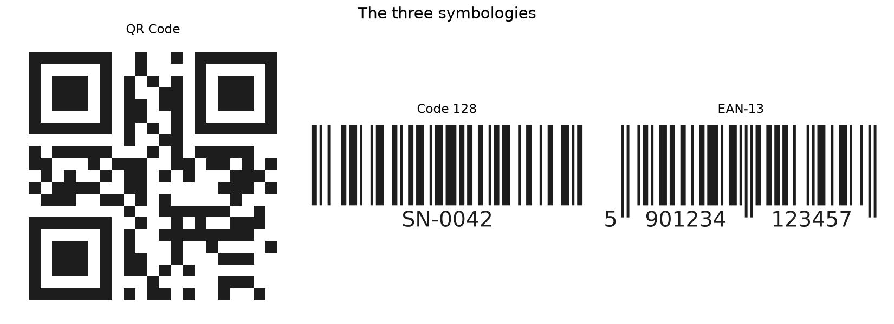
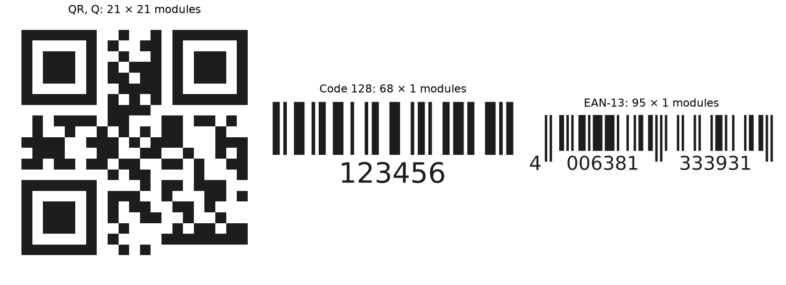
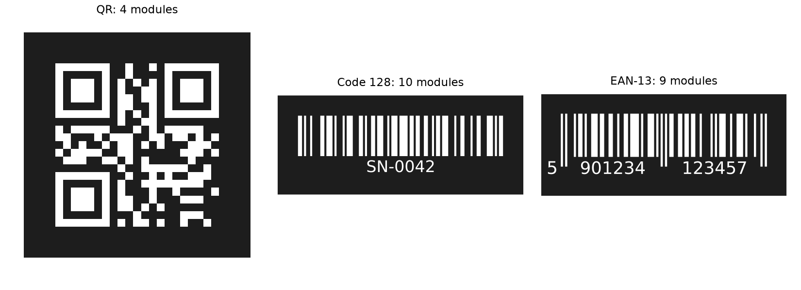

*QR Code, Code 128 and EAN-13, encoded and rendered by raygeo* Barcode and QR code generation.

Encodes text as QR Code, Code 128 or EAN-13 modules, and renders those modules to millimetre-space
geometry with optional human-readable text, quiet-zone border and inverted variant.

The symbology modules expose their own `encode` function; the top-level `encode` dispatches by
`Symbology`. `geometry.to_geometry` turns the encoded modules into closed outlines suitable for
filling or contouring.

## Encoded

An encoded symbol.

### `guards`

```python
guards: list[int]
```

The columns covered by EAN-13 guard bars.

### `height`

```python
height: int
```

The symbol height in modules.

### `modules`

```python
modules: list[list[bool]]
```

The module matrix, row-major, `True` for dark modules.

### `symbology`

```python
symbology: Symbology
```

The symbology that produced this symbol.

### `text`

```python
text: str
```

The human-readable text; EAN-13 includes the check digit.

### `width`

```python
width: int
```

The symbol width in modules.

## QrErrorCorrection

A QR Code error-correction level.

**Values:**

- `H` — High, roughly 30% recovery.
- `L` — Low, roughly 7% recovery.
- `M` — Medium, roughly 15% recovery.
- `Q` — Quartile, roughly 25% recovery.

### `name`

```python
name: str
```

### `value`

```python
value: str
```

The stable serialization value (`"L"`, `"M"`, `"Q"`, `"H"`).

### `from_value()`

```python
from_value(value: str) -> QrErrorCorrection
```

Parses a serialization value produced by **value**.

| Parameter | Type                | Description |
| --------- | ------------------- | ----------- |
| `value`   | `str`               |             |
| _Returns_ | `QrErrorCorrection` |             |

## Symbology

A barcode symbology.

**Values:**

- `CODE128` — Code 128.
- `EAN13` — EAN-13.
- `QR` — QR Code.

### `name`

```python
name: str
```

### `value`

```python
value: str
```

The stable serialization value (`"qr"`, `"code128"`, `"ean13"`).

### `from_value()`

```python
from_value(value: str) -> Symbology
```

Parses a serialization value produced by **value**.

| Parameter | Type        | Description |
| --------- | ----------- | ----------- |
| `value`   | `str`       |             |
| _Returns_ | `Symbology` |             |

## Functions

### `encode()`

```python
encode(
    text: str,
    symbology: Symbology = Symbology.QR,
    error_correction: QrErrorCorrection = QrErrorCorrection.M,
) -> Encoded
```

Encodes text in the requested symbology.

`error_correction` is used by QR only.

| Parameter          | Type                                      | Description |
| ------------------ | ----------------------------------------- | ----------- |
| `text`             | `str`                                     |             |
| `symbology`        | `Symbology = Symbology.QR`                |             |
| `error_correction` | `QrErrorCorrection = QrErrorCorrection.M` |             |
| _Returns_          | `Encoded`                                 |             |



*encode() dispatches to the symbology module and returns modules*

### `min_quiet_zone()`

```python
min_quiet_zone(symbology: Symbology) -> int
```

The minimum quiet zone for a symbology, in modules.

| Parameter   | Type        | Description |
| ----------- | ----------- | ----------- |
| `symbology` | `Symbology` |             |
| _Returns_   | `int`       |             |



*Inverted symbols with the minimum quiet zone per symbology*
