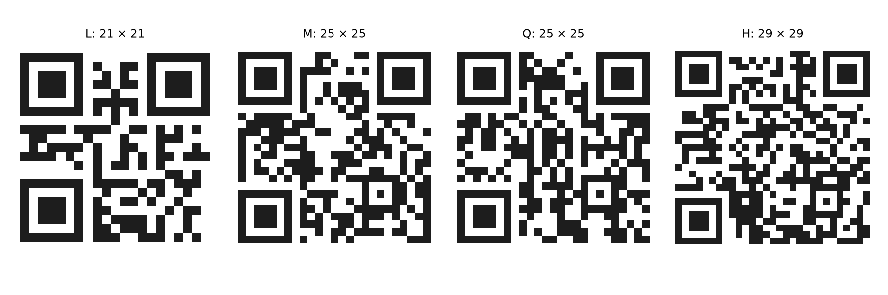

QR Code encoding.

The smallest QR version that fits the text is selected automatically; the requested error-correction
level is kept exactly instead of being boosted to a higher level.

## Functions

### `encode()`

```python
encode(
    text: str,
    error_correction: barcode.QrErrorCorrection = barcode.QrErrorCorrection.M,
) -> barcode.Encoded
```

Encodes text as a QR Code.

| Parameter          | Type                                                      | Description |
| ------------------ | --------------------------------------------------------- | ----------- |
| `text`             | `str`                                                     |             |
| `error_correction` | `barcode.QrErrorCorrection = barcode.QrErrorCorrection.M` |             |
| _Returns_          | `barcode.Encoded`                                         |             |



*The four QR error-correction levels for the same content*
