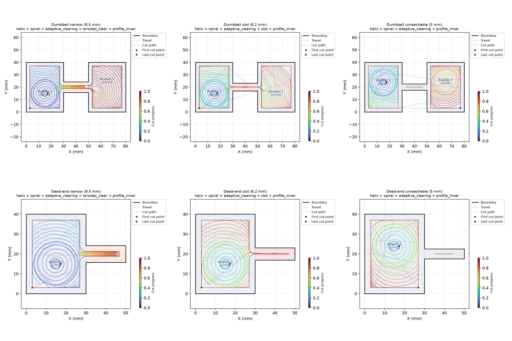
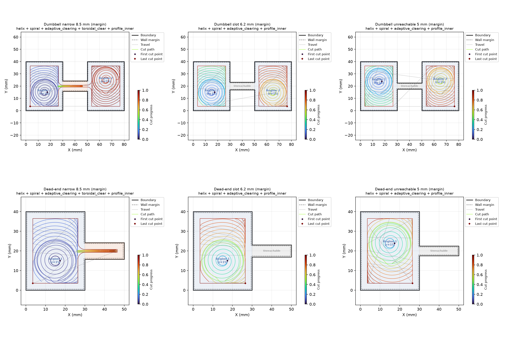

CNC clearing plan builder.

Produces a **~raygeo.cnc.plan.Plan** organised as a BFS traversal of the pocket's region/passage
graph.

## ClearingWorkplanOptions

The tool and machining parameters **plan_clearing** plans from.

The pocket boundary and islands are read from the `Part` — this class carries only the tool and
machining parameters.

### `angular_step`

```python
angular_step: float
```

### `area_tolerance`

```python
area_tolerance: float
```

### `cut_direction`

```python
cut_direction: str
```

`"cw"` or `"ccw"`: how passes walk their loops.

### `feed_rate`

```python
feed_rate: Optional[float]
```

Cut feed rate (mm/min) the plan's moves carry; `None` leaves the cut state unset, for embedders that
map feeds themselves.

### `finishing`

```python
finishing: bool
```

### `max_deflection_deg`

```python
max_deflection_deg: float
```

### `max_entry_angle_deg`

```python
max_entry_angle_deg: float
```

Steepest entry descent in degrees; `<= 0` keeps the planner's historical entry behaviour.

### `plunge_feed`

```python
plunge_feed: Optional[float]
```

Vertical plunge feed (mm/min) for descents into material; `None` falls back to the cut feed.

### `plunge_pitch`

```python
plunge_pitch: float
```

### `safe_margin`

```python
safe_margin: float
```

### `safe_z`

```python
safe_z: float
```

### `step_length`

```python
step_length: float
```

### `step_over`

```python
step_over: float
```

### `stock_to_leave`

```python
stock_to_leave: float
```

### `target_z`

```python
target_z: float
```

### `tool_radius`

```python
tool_radius: float
```

### `travel_mode`

```python
travel_mode: str
```

`"cleared_area"` or `"safe_z"`: how travels are routed.

### `wall_margin`

```python
wall_margin: float
```

### `for_tool()`

```python
for_tool(
    tool_radius: float,
    step_over: float,
    target_z: float,
    safe_z: float,
) -> ClearingWorkplanOptions
```

Options carrying the planner's canonical scales for `tool_radius`: a fifth-of-a-radius step length,
a fifth-of-a-radius safe margin, a plunge pitch of a third of the radius, and the planner's angular
and area tuning (0.1 rad angular steps, a 1.0 mm² area tolerance, 30° max deflection). The
per-operation fields keep their neutral defaults; set `step_over`, `wall_margin`, `stock_to_leave`,
`finishing`, `max_entry_angle_deg` and the feeds on the result.

| Parameter     | Type                      | Description                           |
| ------------- | ------------------------- | ------------------------------------- |
| `tool_radius` | `float`                   | Tool radius in mm.                    |
| `step_over`   | `float`                   | Radial step-over between passes (mm). |
| `target_z`    | `float`                   | Cutting depth (Z).                    |
| `safe_z`      | `float`                   | Safe (rapid) Z height.                |
| _Returns_     | `ClearingWorkplanOptions` |                                       |

## Functions

### `plan_clearing()`

```python
plan_clearing(
    part: part.Part,
    face_id: str = '',
    tool_radius: float = 3.0,
    step_over: float = 2.0,
    step_length: float = 0.6,
    target_z: float = -5.0,
    safe_z: float = 2.0,
    wall_margin: float = 0.0,
    safe_margin: float = 1.0,
    stock_to_leave: float = 0.0,
    plunge_pitch: float = 1.0,
    angular_step: float = 0.1,
    area_tolerance: float = 1.0,
    max_deflection_deg: float = 30.0,
    finishing: bool = False,
    feed_rate: Optional[float] = None,
    plunge_feed: Optional[float] = None,
    max_entry_angle_deg: float = 0.0,
    cut_direction: str = 'ccw',
    travel_mode: str = 'cleared_area',
) -> plan.Plan
```

| Parameter             | Type                     | Description |
| --------------------- | ------------------------ | ----------- |
| `part`                | `part.Part`              |             |
| `face_id`             | `str = ''`               |             |
| `tool_radius`         | `float = 3.0`            |             |
| `step_over`           | `float = 2.0`            |             |
| `step_length`         | `float = 0.6`            |             |
| `target_z`            | `float = -5.0`           |             |
| `safe_z`              | `float = 2.0`            |             |
| `wall_margin`         | `float = 0.0`            |             |
| `safe_margin`         | `float = 1.0`            |             |
| `stock_to_leave`      | `float = 0.0`            |             |
| `plunge_pitch`        | `float = 1.0`            |             |
| `angular_step`        | `float = 0.1`            |             |
| `area_tolerance`      | `float = 1.0`            |             |
| `max_deflection_deg`  | `float = 30.0`           |             |
| `finishing`           | `bool = False`           |             |
| `feed_rate`           | `Optional[float] = None` |             |
| `plunge_feed`         | `Optional[float] = None` |             |
| `max_entry_angle_deg` | `float = 0.0`            |             |
| `cut_direction`       | `str = 'ccw'`            |             |
| `travel_mode`         | `str = 'cleared_area'`   |             |
| _Returns_             | `plan.Plan`              |             |



*Clearing workplan: narrow passage (ToroidalClear), slot (Slot), dual-entry dumbbell (Unreachable).*



*The same pockets with a 0.5 mm wall margin: too-narrow passages stay uncut.*
