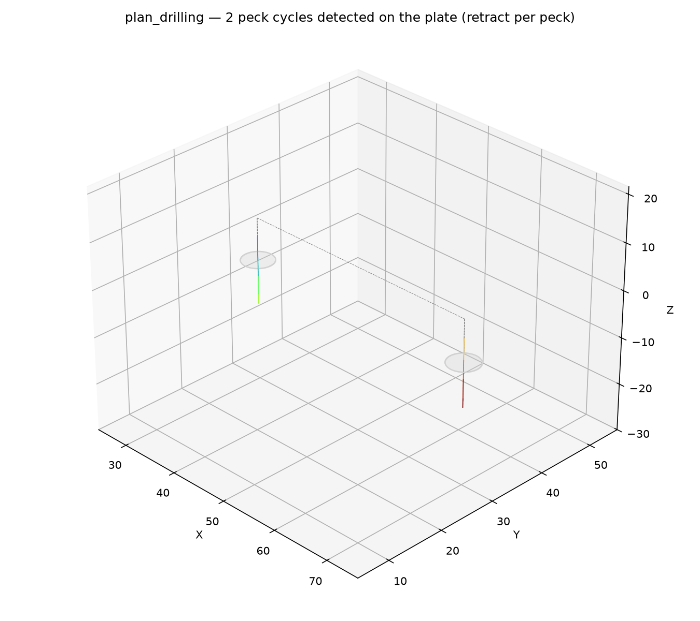
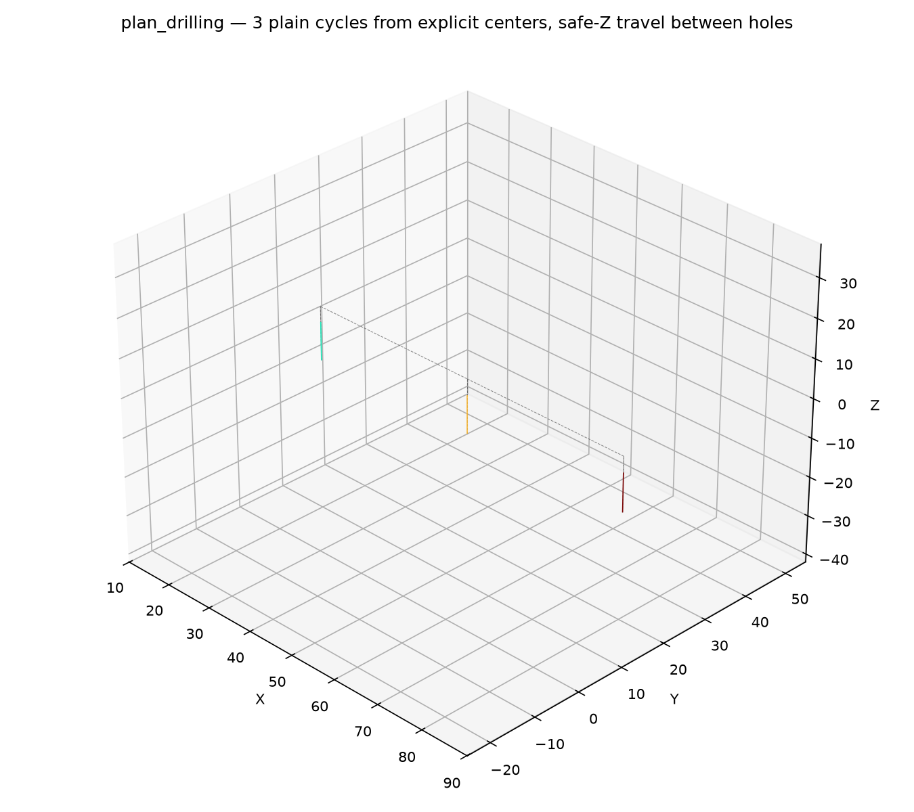

CNC drilling plan builder.

Produces a plan that drills holes: one cycle per hole, all sharing the same parameters. Holes come
either from an explicit center list or are detected automatically as circular island contours of the
face. Cycles are expanded into explicit moves and wrapped in DRILL_CYCLE sections so encoders can
substitute canned cycles.

## Functions

### `plan_drilling()`

```python
plan_drilling(
    part: ops.part.Part,
    face_id: str = '',
    cycle: str = 'plain',
    diameter: float = 5,
    target_z: float = -10,
    tip_angle_deg: float = 118,
    z_surface: float = 0,
    rapid_z: float = 1,
    safe_z: float = 5,
    peck_increment: float = 1,
    chip_break_retract: float = 0.5,
    dwell_ms: float = 0,
    feed_rate: Optional[float] = None,
    plunge_feed: Optional[float] = None,
    spindle_rpm: Optional[int] = None,
    coolant: Optional[str] = None,
    holes: Optional[Sequence[tuple[float, float]]] = None,
    hole_tolerance: float = 0.1,
    hole_order: str = 'detection',
) -> cnc.plan.Plan
```

Build a plan that drills holes on one face.

One cycle per hole; all holes share the parameters. Holes come from `holes` when given (explicit
centers, in solid material — typical for spot drilling), otherwise they are detected as circular
island contours of the face (existing bores, e.g. to re-drill or countersink). Islands smaller than
the drill diameter are skipped in detection mode. `target_z` is the full-diameter depth; the tip
descends deeper by the tip compensation `(diameter / 2) / tan(tip_angle / 2)`. Holes needing
different depths or parameters need a separate call.

Cycles: `"plain"` single plunge, `"spot"` shallow marking cycle, `"peck"` full-retract pecking
(G83), `"chip_break"` chip-break pecking (G73).

| Parameter            | Type                                             | Description                                                                                                       |
| -------------------- | ------------------------------------------------ | ----------------------------------------------------------------------------------------------------------------- |
| `part`               | `ops.part.Part`                                  | part whose face is drilled.                                                                                       |
| `face_id`            | `str = ''`                                       | face to drill ("" is the default face).                                                                           |
| `cycle`              | `str = 'plain'`                                  | `"plain"`, `"spot"`, `"peck"` or `"chip_break"`.                                                                  |
| `diameter`           | `float = 5`                                      | drill (and hole) diameter (mm).                                                                                   |
| `target_z`           | `float = -10`                                    | full-diameter depth (mm).                                                                                         |
| `tip_angle_deg`      | `float = 118`                                    | drill point angle in degrees (default 118).                                                                       |
| `z_surface`          | `float = 0`                                      | surface Z the holes start at (default 0).                                                                         |
| `rapid_z`            | `float = 1`                                      | rapid plane above the surface (default 1).                                                                        |
| `safe_z`             | `float = 5`                                      | safe rapid height (default 5).                                                                                    |
| `peck_increment`     | `float = 1`                                      | axial depth per peck (mm); pecking cycles only.                                                                   |
| `chip_break_retract` | `float = 0.5`                                    | chip-break retract distance (mm); chip-break only.                                                                |
| `dwell_ms`           | `float = 0`                                      | dwell at the bottom of every plunge (ms).                                                                         |
| `feed_rate`          | `Optional[float] = None`                         | cut feed (mm/min); None leaves the plan's cut state unset.                                                        |
| `plunge_feed`        | `Optional[float] = None`                         | vertical plunge feed (mm/min); None falls back to the cut feed.                                                   |
| `spindle_rpm`        | `Optional[int] = None`                           | spindle speed (rpm).                                                                                              |
| `coolant`            | `Optional[str] = None`                           | `"flood"`, `"mist"` or `"off"`; None leaves the plan's coolant unset.                                             |
| `holes`              | `Optional[Sequence[tuple[float, float]]] = None` | explicit hole centers `[(x, y), ...]`; None detects circular islands on the face.                                 |
| `hole_tolerance`     | `float = 0.1`                                    | max distance (mm) between an island contour sample and the fitted circle for it to count as a hole (default 0.1). |
| `hole_order`         | `str = 'detection'`                              | `"detection"` or `"nearest_neighbor"`.                                                                            |
| _Returns_            | `cnc.plan.Plan`                                  | the drilling plan, one step per hole.                                                                             |



*Peck drilling of two holes detected as circular islands; each peck retracts to the rapid plane.*



*Plain cycles at explicit centers in solid material with safe-Z travel between holes.*
