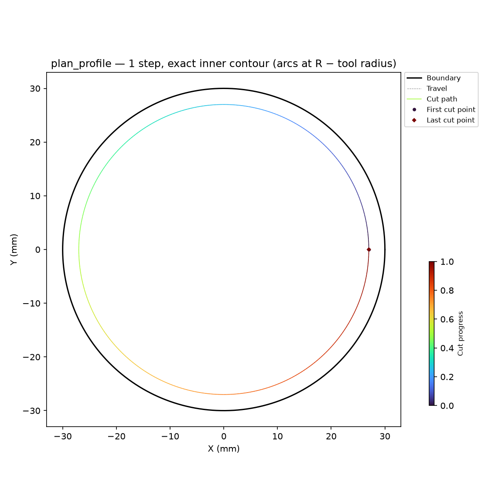
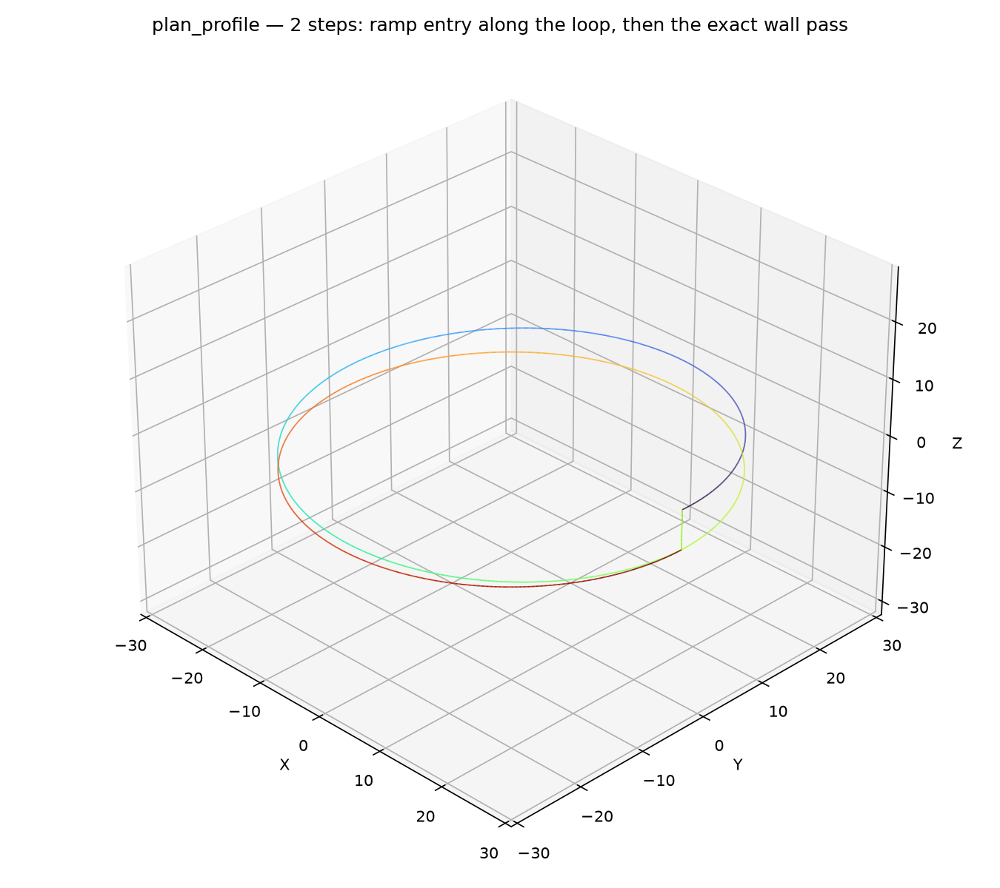

CNC profile plan builder.

Produces a one-step **~raygeo.cnc.plan.Plan** that profiles the face boundary: the inset (inner) or
grown (outer) offset, walked once at the target depth.

## Functions

### `plan_profile()`

```python
plan_profile(
    part: ops.part.Part,
    face_id: str = '',
    side: str = 'inner',
    tool_radius: float = 3,
    step_over: float = 2,
    step_length: float = 0.6,
    target_z: float = -5,
    safe_z: float = 2,
    wall_margin: float = 0,
    stock_to_leave: float = 0,
    cut_direction: str = 'ccw',
    ramp_angle_deg: float = 0,
    tolerance: float = 0.1,
    feed_rate: Optional[float] = None,
    plunge_feed: Optional[float] = None,
) -> cnc.plan.Plan
```

Build a plan that profiles a face boundary. The step walks the inset boundary (side "inner", the
pocket side) or the grown boundary (side "outer", around the part) once at the target depth,
honouring islands on the inner side. Curve-true face geometry is followed exactly, with arcs emitted
as arcs; polygon-only parts take the chord path.

With `ramp_angle_deg` above 0 and curve-true face geometry, the plan prepends a ramp-entry step that
descends along the profile loop at that angle, so the tool enters the material gradually instead of
plunging.

| Parameter        | Type                     | Description                                                               |
| ---------------- | ------------------------ | ------------------------------------------------------------------------- |
| `part`           | `ops.part.Part`          | part whose face is profiled.                                              |
| `face_id`        | `str = ''`               | face to profile ("" is the default face).                                 |
| `side`           | `str = 'inner'`          | `"inner"` or `"outer"`.                                                   |
| `tool_radius`    | `float = 3`              | tool radius (mm).                                                         |
| `step_over`      | `float = 2`              | radial step-over between passes (mm); at most the tool diameter.          |
| `step_length`    | `float = 0.6`            | forward step length (mm).                                                 |
| `target_z`       | `float = -5`             | cutting depth (mm).                                                       |
| `safe_z`         | `float = 2`              | safe rapid height (mm).                                                   |
| `wall_margin`    | `float = 0`              | extra distance to keep from the wall (mm).                                |
| `stock_to_leave` | `float = 0`              | stock left on the wall (mm).                                              |
| `cut_direction`  | `str = 'ccw'`            | `"ccw"` (wall on the left, climb for a clockwise spindle) or `"cw"`.      |
| `ramp_angle_deg` | `float = 0`              | steepest entry descent along the loop (degrees); 0 plunges straight down. |
| `tolerance`      | `float = 0.1`            | boundary-following tolerance (mm).                                        |
| `feed_rate`      | `Optional[float] = None` | cut feed (mm/min); None leaves the plan's cut state unset.                |
| `plunge_feed`    | `Optional[float] = None` | vertical plunge feed (mm/min); None falls back to the cut feed.           |
| _Returns_        | `cnc.plan.Plan`          | the profile plan.                                                         |



*Profile workplan: one exact inner contour step on a circular part, cut in true arcs.*



*Profile workplan with a ramp entry: the tool descends along the loop before the wall pass.*
