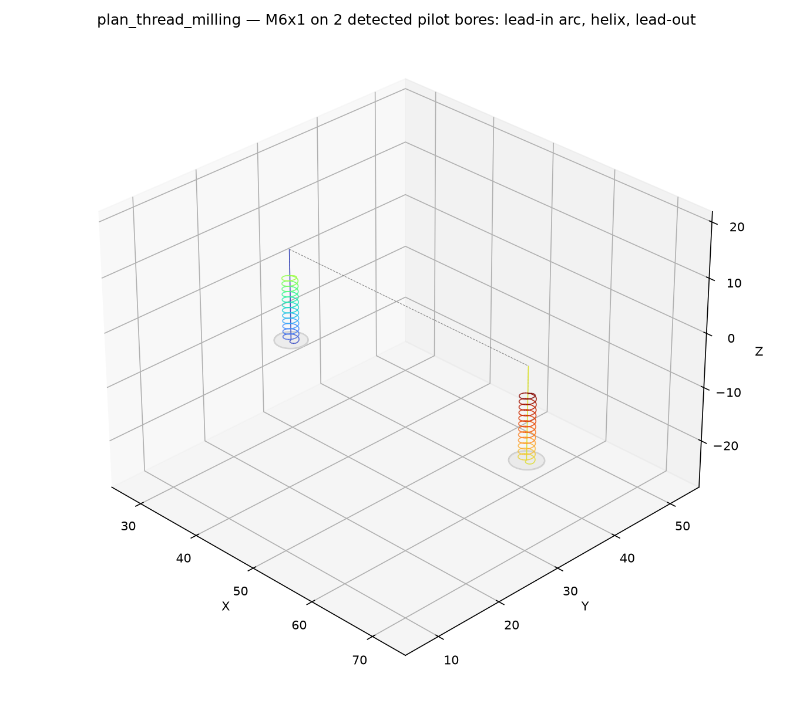

CNC thread-milling plan builder.

Produces a plan that thread-mills internal threads: one helical interpolation cycle per pilot bore,
all sharing the same thread parameters. Bores come either from an explicit center list or are
detected automatically as circular island contours of the face and validated against the thread
geometry.

## Functions

### `plan_thread_milling()`

```python
plan_thread_milling(
    part: ops.part.Part,
    face_id: str = '',
    nominal_diameter: float = 6,
    pitch: float = 1,
    tool_diameter: float = 4,
    z_top: float = 0,
    z_bottom: float = -12,
    handedness: str = 'rh',
    safe_z: float = 5,
    feed_rate: Optional[float] = None,
    plunge_feed: Optional[float] = None,
    spindle_rpm: Optional[int] = None,
    coolant: Optional[str] = None,
    holes: Optional[Sequence[tuple[float, float]]] = None,
    hole_tolerance: float = 0.1,
    hole_order: str = 'detection',
) -> cnc.plan.Plan
```

Build a plan that thread-mills internal threads on one face.

One helical-interpolation cycle per pilot bore; all bores share the thread parameters. Bores come
from `holes` when given (explicit centers), otherwise they are detected as circular island contours
of the face and validated: the thread mill must fit into the bore, and the bore must not be
oversized beyond the thread minor diameter (or there is nothing left to thread). The thread length
(`z_top - z_bottom`) must be an integer multiple of the pitch. Bores needing different parameters
need a separate call.

| Parameter          | Type                                             | Description                                                                                                       |
| ------------------ | ------------------------------------------------ | ----------------------------------------------------------------------------------------------------------------- |
| `part`             | `ops.part.Part`                                  | part whose face is threaded.                                                                                      |
| `face_id`          | `str = ''`                                       | face to thread ("" is the default face).                                                                          |
| `nominal_diameter` | `float = 6`                                      | nominal (major) thread diameter (mm).                                                                             |
| `pitch`            | `float = 1`                                      | thread pitch (lead) (mm).                                                                                         |
| `tool_diameter`    | `float = 4`                                      | thread mill cutter diameter (mm); must be below the minor diameter.                                               |
| `z_top`            | `float = 0`                                      | Z of the top end of the thread (default 0).                                                                       |
| `z_bottom`         | `float = -12`                                    | Z of the bottom end of the thread.                                                                                |
| `handedness`       | `str = 'rh'`                                     | `"rh"` (default) or `"lh"`.                                                                                       |
| `safe_z`           | `float = 5`                                      | safe rapid height (default 5).                                                                                    |
| `feed_rate`        | `Optional[float] = None`                         | cut feed (mm/min); None leaves the plan's cut state unset.                                                        |
| `plunge_feed`      | `Optional[float] = None`                         | vertical plunge feed (mm/min); None falls back to the cut feed.                                                   |
| `spindle_rpm`      | `Optional[int] = None`                           | spindle speed (rpm).                                                                                              |
| `coolant`          | `Optional[str] = None`                           | `"flood"`, `"mist"` or `"off"`; None leaves the plan's coolant unset.                                             |
| `holes`            | `Optional[Sequence[tuple[float, float]]] = None` | explicit pilot-bore centers `[(x, y), ...]`; None detects circular islands on the face.                           |
| `hole_tolerance`   | `float = 0.1`                                    | max distance (mm) between an island contour sample and the fitted circle for it to count as a bore (default 0.1). |
| `hole_order`       | `str = 'detection'`                              | `"detection"` or `"nearest_neighbor"`.                                                                            |
| _Returns_          | `cnc.plan.Plan`                                  | the thread-milling plan, one step per bore.                                                                       |



*Thread milling M6x1 threads on two detected pilot bores; the helix climbs one pitch per
revolution.*
