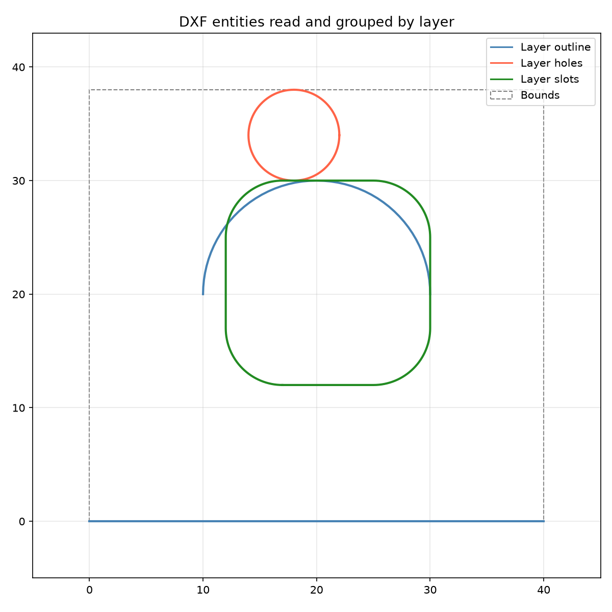
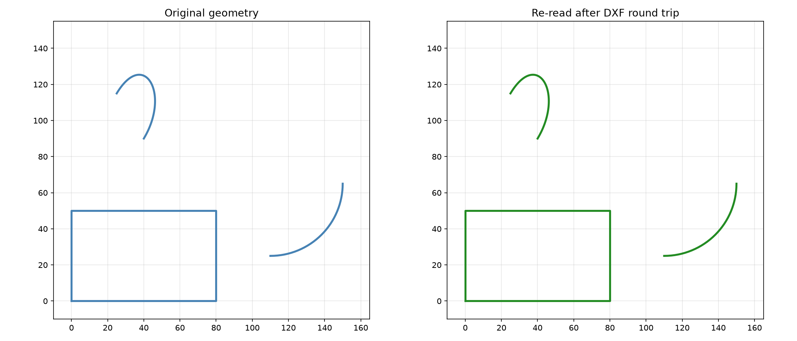
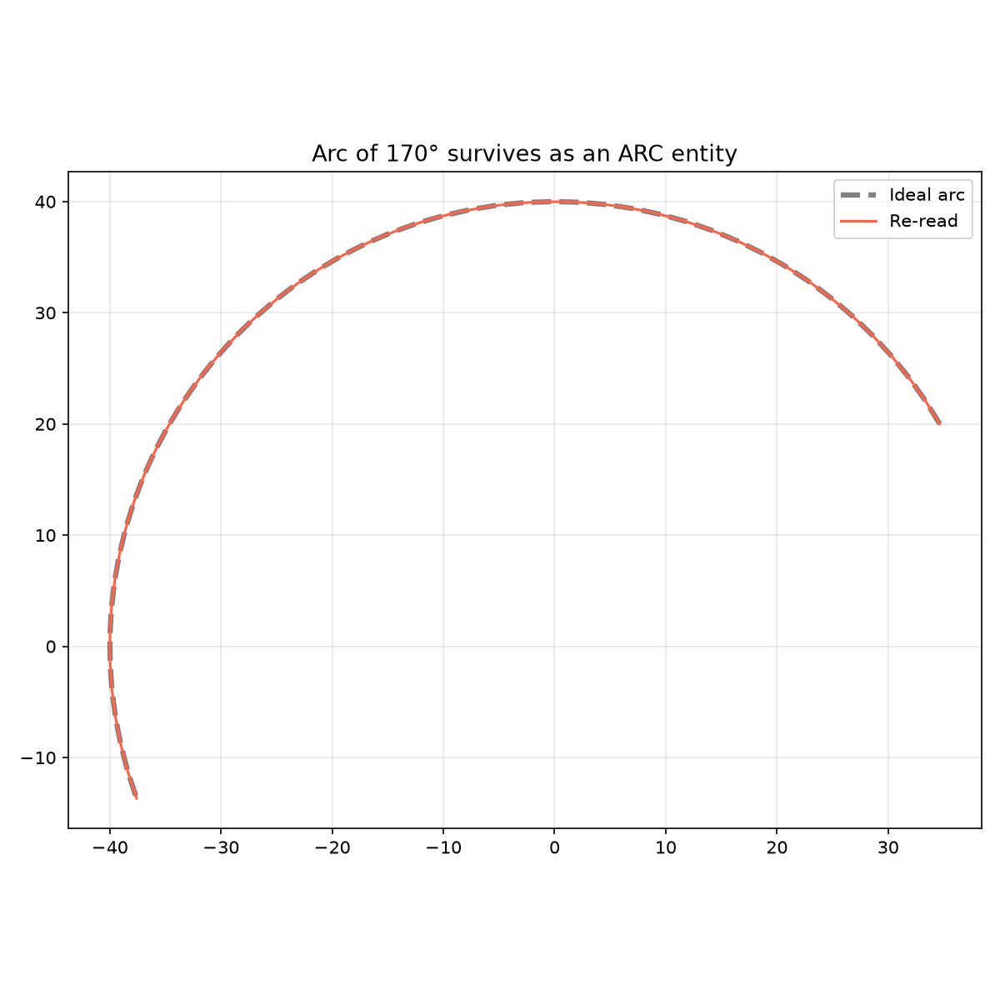

DXF (Drawing Exchange Format) reading and writing.

Reads the ASCII DXF files CAD applications export for laser cutting: lines, arcs, circles, ellipses,
polylines with bulges, splines, text and the block insertions that 3D CAD tools wrap their export
in.

The reader never fails on a single unreadable entity. Anything it could not represent is reported in
`ReadOutput.issues`, so a file that is partly unsupported still imports the parts that are.
Coordinates are in native drawing units with Y pointing up; multiply by `ReadOutput.units_to_mm` to
convert.

## ReadOutput

The geometry and metadata a DXF reader extracted from a document.

### `bounds`

```python
bounds: Rect
```

Bounding rectangle of all drawn content, in native units.

### `is_y_down`

```python
is_y_down: bool
```

Whether the native Y axis points down. Always `False` for DXF.

### `issues`

```python
issues: list[str]
```

Notes about content that was skipped or approximated.

### `layers`

```python
layers: list[tuple[str, geo.Geometry]]
```

One geometry per layer, as `(layer_name, geometry)` pairs in document order.

### `max_z`

```python
max_z: float
```

Highest Z value the drawing spans, in native units.

### `min_z`

```python
min_z: float
```

Lowest Z value the drawing spans, in native units.

### `units_to_mm`

```python
units_to_mm: float
```

Multiplier converting native units to millimetres.

### `has_z_variation()`

```python
has_z_variation(tolerance: float = 0.0001) -> bool
```

True when the drawing spans more than one Z level.

| Parameter   | Type             | Description                                                      |
| ----------- | ---------------- | ---------------------------------------------------------------- |
| `tolerance` | `float = 0.0001` | Smallest Z difference that counts as variation, in native units. |
| _Returns_   | `bool`           |                                                                  |

### `is_empty()`

```python
is_empty() -> bool
```

True when nothing drawable was found.

| Parameter | Type   | Description |
| --------- | ------ | ----------- |
| _Returns_ | `bool` |             |

## Rect

A rectangle in the drawing's own coordinates.

### `height`

```python
height: float
```

Height of the rectangle.

### `max_x`

```python
max_x: float
```

Right edge.

### `max_y`

```python
max_y: float
```

The other extreme of the vertical axis.

### `min_x`

```python
min_x: float
```

Left edge.

### `min_y`

```python
min_y: float
```

Top or bottom edge, depending on the drawing's Y direction.

### `width`

```python
width: float
```

Width of the rectangle.

## Functions

### `read()`

```python
read(data: str) -> dxf.ReadOutput
```

Read a DXF document into geometry.

Supports lines, arcs, circles, ellipses, polylines with bulges, splines (including NURBS), text
rendered through the system font, and block insertions, which are flattened into the drawing.
Content the reader cannot represent is listed in `issues` rather than raising.

**Raises:** `ValueError` — When the input is not a group-code stream.

| Parameter    | Type             | Description                                                                                                   |
| ------------ | ---------------- | ------------------------------------------------------------------------------------------------------------- |
| `data`       | `str`            | The DXF file contents as text.                                                                                |
| _Returns_    | `dxf.ReadOutput` | Per-layer geometry in native units, Y up, with the drawing bounds, the unit conversion factor and any issues. |
| _Complexity_ |                  | O(n) where n = size of the document                                                                           |



*Lines, arcs, circles and bulges grouped by layer*

### `write()`

```python
write(geometry: geo.Geometry) -> str
```

Write geometry as a DXF document.

The output is R12-compatible ASCII DXF with millimetres declared as the unit, which is the variant
every CAD tool and laser cutter controller accepts. Consecutive lines become one `LWPOLYLINE`, arcs
remain `ARC` entities, and beziers are written as splines.

| Parameter    | Type           | Description                            |
| ------------ | -------------- | -------------------------------------- |
| `geometry`   | `geo.Geometry` | The geometry to write, in millimetres. |
| _Returns_    | `str`          | The DXF document as text.              |
| _Complexity_ |                | O(n) where n = number of commands      |



*Geometry written as DXF and read back*



*Arcs stay as ARC entities, so a round trip is lossless*
