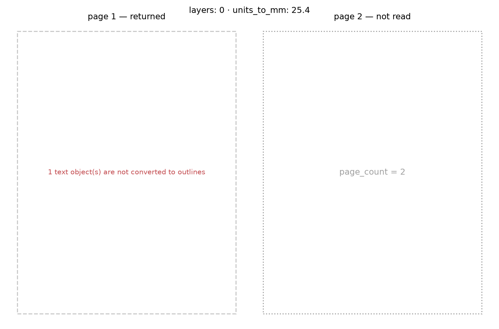

*Two drawings parsed natively: page frame, layers and geometry* CorelDRAW (`.cdr`) import.

Parses the drawing natively: RIFF and ZIP containers, compressed chunk lists, object records and
their transforms are all read in Rust, so no external tool or C library is needed. Text, bitmaps and
object kinds the reader does not know are reported in **CdrDocument.issues** instead of being
converted.

## CdrDocument

The geometry of a CorelDRAW page.

### `issues`

```python
issues: list[str]
```

Content the reader did not convert, one note per category.

### `layers`

```python
layers: list[tuple[str, geo.Geometry]]
```

The layers of the first page, bottom to top, as `(name, geometry)` pairs. The geometry is in inches,
relative to the page's bottom-left corner.

### `page_count`

```python
page_count: int
```

The number of non-master pages in the document.

### `page_height`

```python
page_height: float
```

The page height in inches.

### `page_width`

```python
page_width: float
```

The page width in inches.

### `units_to_mm`

```python
units_to_mm: float
```

Multiplier converting the native unit (inches) to millimetres.

## CdrError

Base class of the CorelDRAW reader errors.

## CdrFormat

The kind of Corel document a byte stream holds.

**Values:**

- `CDR` — A CorelDRAW drawing (`.cdr`).
- `CMX` — A Corel Presentation Exchange file (`.cmx`).

## CdrParseError

Raised when a CorelDRAW container, record or argument table cannot be read.

## CdrUnsupportedFormat

Raised when the data is not a CorelDRAW or CMX document.

## Functions

### `detect_format()`

```python
detect_format(data: bytes) -> formats.coreldraw.CdrFormat | None
```

Return the kind of Corel document in `data`.

Recognizes a bare RIFF drawing, a ZIP package holding one, and the earliest `WL` format; CMX files
are recognized but not read.

| Parameter    | Type                                      | Description                                                         |
| ------------ | ----------------------------------------- | ------------------------------------------------------------------- |
| `data`       | `bytes`                                   | The first bytes of the file, or the whole file.                     |
| _Returns_    | `formats.coreldraw.CdrFormat &#124; None` | The document kind, or `None` when the data is not a Corel document. |
| _Complexity_ |                                           | O(n) where n = size of the data                                     |


*Container and version recognized from the leading bytes*

### `parse()`

```python
parse(data: bytes) -> formats.coreldraw.CdrDocument
```

Read a CorelDRAW drawing into the geometry of its first page.

The whole file is parsed in Rust: RIFF and ZIP containers, compressed chunk lists, object records
and their transforms. Only drawing geometry is extracted; text, bitmaps and unknown object kinds are
listed in `issues`. The layers of the first page come bottom to top, their geometry in inches with
the page origin at the bottom-left corner.

**Raises:** `CdrUnsupportedFormat` — When the data is not a CorelDRAW

```
document.
```

**Raises:** `CdrParseError` — When the container, a record or an argument

```
table cannot be read, or when the file is a CMX file.
```

| Parameter    | Type                            | Description                                          |
| ------------ | ------------------------------- | ---------------------------------------------------- |
| `data`       | `bytes`                         | The document's bytes.                                |
| _Returns_    | `formats.coreldraw.CdrDocument` | The page size, its layers and the conversion issues. |
| _Complexity_ |                                 | O(n) where n = size of the document                  |



*A two-page document: page one is returned, the text is noted as an issue*
