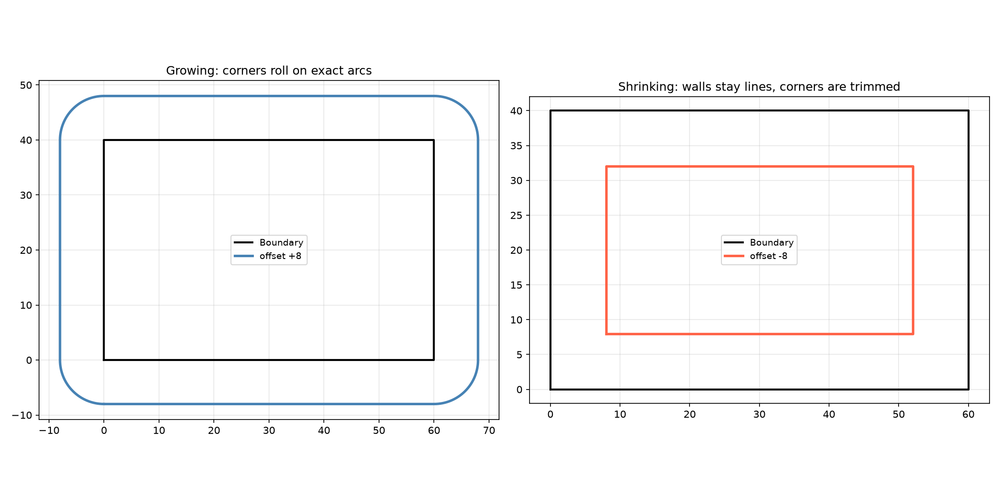
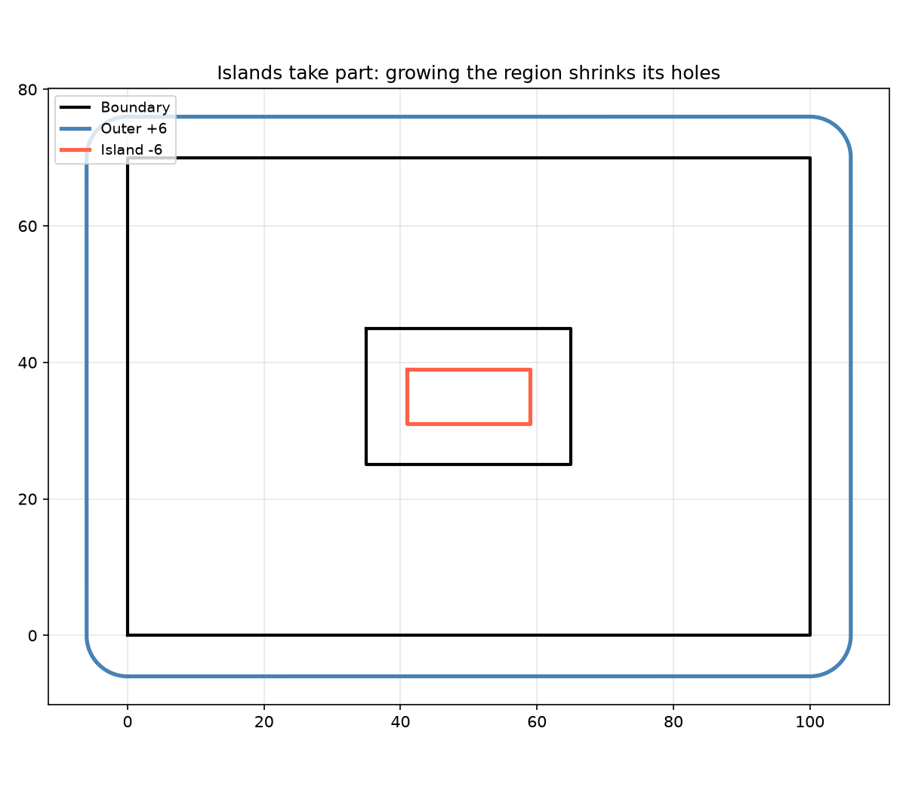
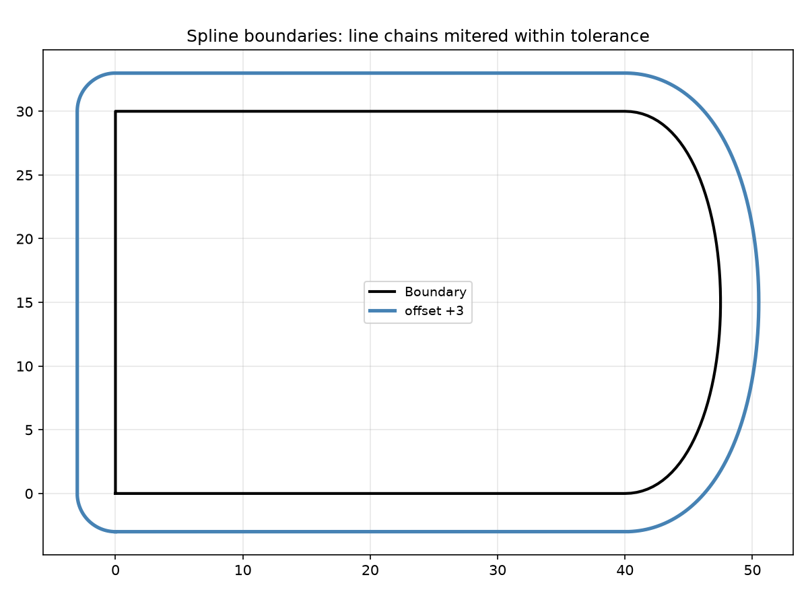

Exact offsetting of closed line-and-arc contours.

Offsets boundaries keeping lines and arcs exact, so an arc wall comes out as an arc rather than a
chord approximation.

## Functions

### `offset_exact()`

```python
offset_exact(
    geometry: geo.Geometry,
    offset: float,
    tolerance: float = 0.1,
) -> list[geo.Geometry]
```

Offset the closed line-and-arc contours of a geometry exactly.

Every closed subpath takes part: counter-clockwise loops bound material, clockwise ones bound holes.
Lines and arcs stay exact (arc walls come out as arcs); other curves are followed as line chains
within `tolerance`. Open subpaths are ignored. A positive `offset` grows the region, a negative one
shrinks it.

| Parameter    | Type                 | Description                                       |
| ------------ | -------------------- | ------------------------------------------------- |
| `geometry`   | `geo.Geometry`       | geometry whose closed subpaths are offset.        |
| `offset`     | `float`              | offset distance; positive grows the region.       |
| `tolerance`  | `float = 0.1`        | line-chain tolerance for non-line-and-arc curves. |
| _Returns_    | `list[geo.Geometry]` | the offset closed loops, one geometry per loop.   |
| _Complexity_ |                      | O(n^2) in the number of boundary pieces.          |



*Exact offsets of a rectangle: growing rolls the corners on arcs, shrinking keeps the walls
straight.*



*Every closed subpath takes part: growing the region moves the island's boundary inwards.*



*A spline boundary is followed as a line chain, mitered while that stays within the tolerance.*
