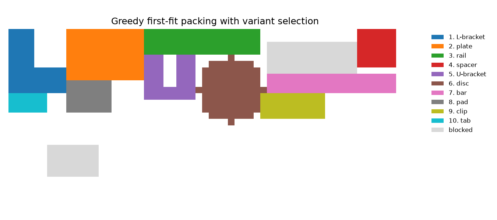

*Greedy first-fit packing with variant selection*

## Packer

Greedy first-fit packer for binary canvases.

The canvas is a 2-D uint8 array where nonzero pixels are occupied. Each call to **place** tests
every supplied footprint (one per allowed rotation), records the first collision-free position in
row-major order, and chooses the footprint whose placement yields the smallest combined bounding
box. The chosen footprint is then marked on the canvas.

### `place()`

```python
place(
    masks: Sequence[numpy.NDArray[numpy.uint8]],
) -> Optional[tuple[int, int, int]]
```

Places one item and marks it on the canvas.

| Parameter    | Type                                   | Description                                                                             |
| ------------ | -------------------------------------- | --------------------------------------------------------------------------------------- |
| `masks`      | `Sequence[numpy.NDArray[numpy.uint8]]` | One 2-D uint8 footprint per allowed rotation; nonzero pixels are part of the footprint. |
| _Returns_    | `Optional[tuple[int, int, int]]`       | `(variant_index, y, x)` for the best placement, or `None` when no variant fits.         |
| _Complexity_ |                                        | O(k * w * h * log(w * h)) for k variants                                                |
