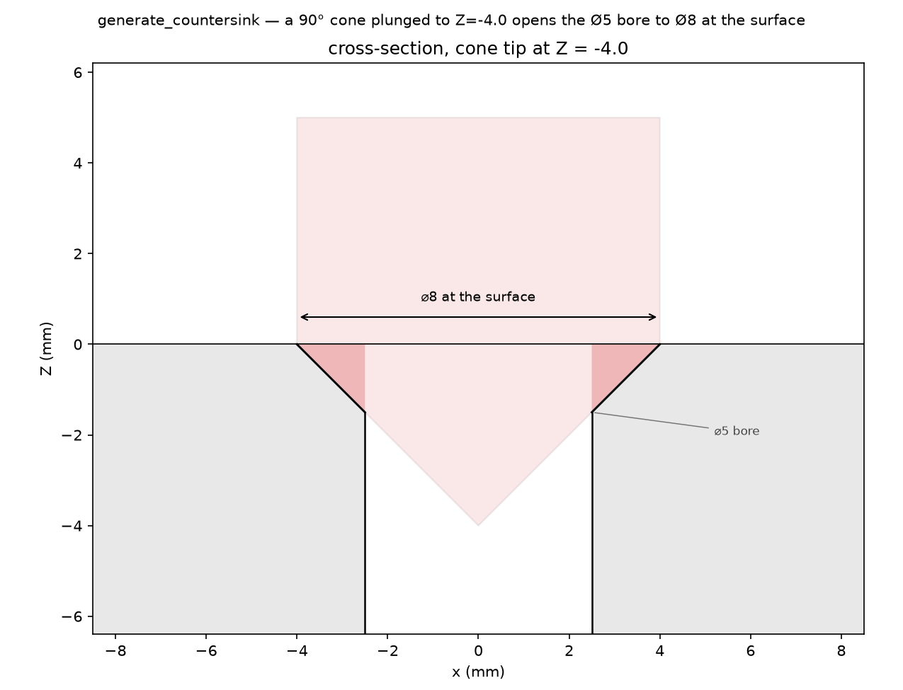
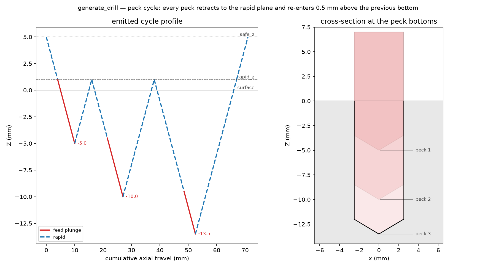
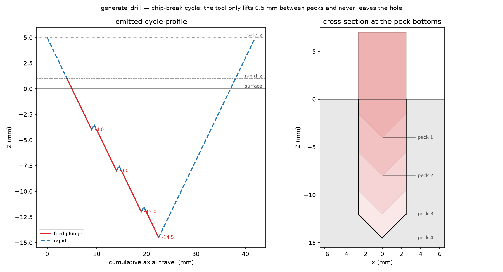

## CountersinkSpec

Parameters for the `countersink` assembler: one conical plunge at one hole.

### `center`

```python
center: tuple[float, float]
```

### `dwell_ms`

```python
dwell_ms: float
```

### `rapid_z`

```python
rapid_z: float
```

### `safe_z`

```python
safe_z: float
```

### `target_diameter`

```python
target_diameter: float
```

Chamfer diameter produced at the surface (mm).

### `tip_angle`

```python
tip_angle: float
```

Included angle of the countersink cone in degrees.

### `z_surface`

```python
z_surface: float
```

## DrillSpec

Parameters for the `drill` assembler: one cycle at one hole.

### `center`

```python
center: tuple[float, float]
```

### `diameter`

```python
diameter: float
```

Drill (and hole) diameter (mm).

### `dwell_ms`

```python
dwell_ms: float
```

Dwell at the bottom of every plunge (ms).

### `peck`

```python
peck: Optional[PeckParams]
```

### `rapid_z`

```python
rapid_z: float
```

Rapid plane just above the surface.

### `safe_z`

```python
safe_z: float
```

Safe rapid height.

### `spot`

```python
spot: bool
```

Marks the cycle as a spot drill.

### `target_z`

```python
target_z: float
```

Full-diameter depth of the hole (mm).

### `tip_angle`

```python
tip_angle: float
```

Drill point angle in degrees (tip compensation).

### `tip_compensate`

```python
tip_compensate: bool
```

When true (default), `target_z` is the full-diameter depth and the tip descends deeper by the tip
compensation. When false, `target_z` is the depth the tip reaches.

### `z_surface`

```python
z_surface: float
```

Surface Z the hole starts at.

## PeckParams

Peck cycle parameters.

### `increment`

```python
increment: float
```

Axial depth per peck, measured from the surface (mm).

### `mode`

```python
mode: str
```

`"FULL_RETRACT"` (clear the flutes from the hole, G83) or `"CHIP_BREAK"` (small retract, G73).

### `retract_amount`

```python
retract_amount: float
```

Chip-break retract distance above the current depth (mm); only used with `"CHIP_BREAK"`.

## Functions

### `generate_countersink()`

```python
generate_countersink(
    part: ops.part.Part,
    center: tuple[float, float],
    tip_angle: float,
    target_diameter: float,
    z_surface: float = 0,
    rapid_z: float = 1,
    safe_z: float = 5,
    dwell_ms: float = 0,
    state: ops.state.State | None = None,
) -> ops.assembly.AssemblyResult
```

Generate one countersink cycle as explicit moves.

Plunges a conical countersink tool to the depth that produces `target_diameter` at the surface with
the given cone angle. The cycle is wrapped in a `DRILL_CYCLE` section.

| Parameter         | Type                                 | Description                                                  |
| ----------------- | ------------------------------------ | ------------------------------------------------------------ |
| `part`            | `ops.part.Part`                      | part owning the face the cycle is assembled on.              |
| `center`          | `tuple[float, float]`                | `(x, y)` of the hole.                                        |
| `tip_angle`       | `float`                              | included angle of the countersink cone in degrees (e.g. 90). |
| `target_diameter` | `float`                              | chamfer diameter at the surface (mm).                        |
| `z_surface`       | `float = 0`                          | surface Z (default 0).                                       |
| `rapid_z`         | `float = 1`                          | rapid plane above the surface (default 1).                   |
| `safe_z`          | `float = 5`                          | safe rapid height (default 5).                               |
| `dwell_ms`        | `float = 0`                          | dwell at the bottom (ms).                                    |
| `state`           | `ops.state.State &#124; None = None` | optional machine state (feeds, spindle, coolant).            |
| _Returns_         | `ops.assembly.AssemblyResult`        | An **AssemblyResult** with the cycle's moves.                |



*Countersink cross-section: the cone meets the surface exactly at the target diameter.*

### `generate_drill()`

```python
generate_drill(
    part: ops.part.Part,
    center: tuple[float, float],
    diameter: float,
    target_z: float,
    tip_angle: float = 118,
    z_surface: float = 0,
    rapid_z: float = 1,
    safe_z: float = 5,
    peck: ops.assembly.drill.PeckParams | None = None,
    dwell_ms: float = 0,
    spot: bool = False,
    state: ops.state.State | None = None,
) -> ops.assembly.AssemblyResult
```

Generate one drilling cycle as explicit moves.

Rapids to the safe plane and the rapid plane, plunges at the plunge feed (with dwell), retracts per
the peck mode, and retracts to the safe plane. `target_z` is the full-diameter depth; the tip
descends deeper by the tip compensation `(diameter / 2) / tan(tip_angle / 2)`. The whole cycle is
wrapped in a `DRILL_CYCLE` section so encoders can substitute a canned cycle.

| Parameter   | Type                                               | Description                                       |
| ----------- | -------------------------------------------------- | ------------------------------------------------- |
| `part`      | `ops.part.Part`                                    | part owning the face the cycle is assembled on.   |
| `center`    | `tuple[float, float]`                              | `(x, y)` of the hole.                             |
| `diameter`  | `float`                                            | drill (and hole) diameter (mm).                   |
| `target_z`  | `float`                                            | full-diameter depth (mm).                         |
| `tip_angle` | `float = 118`                                      | drill point angle in degrees (default 118).       |
| `z_surface` | `float = 0`                                        | surface Z the hole starts at (default 0).         |
| `rapid_z`   | `float = 1`                                        | rapid plane above the surface (default 1).        |
| `safe_z`    | `float = 5`                                        | safe rapid height (default 5).                    |
| `peck`      | `ops.assembly.drill.PeckParams &#124; None = None` | peck parameters; None drills in a single plunge.  |
| `dwell_ms`  | `float = 0`                                        | dwell at the bottom of every plunge (ms).         |
| `spot`      | `bool = False`                                     | marks the cycle as a spot drill.                  |
| `state`     | `ops.state.State &#124; None = None`               | optional machine state (feeds, spindle, coolant). |
| _Returns_   | `ops.assembly.AssemblyResult`                      | An **AssemblyResult** with the cycle's moves.     |



*Peck cycle: emitted plunge/retract profile (left) and cross-section with tool ghosts (right).*



*Chip-break cycle: profile and cross-section; the tool never leaves the hole between pecks.*
