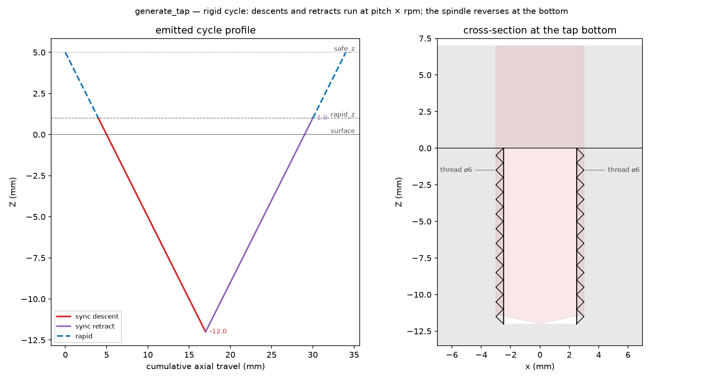
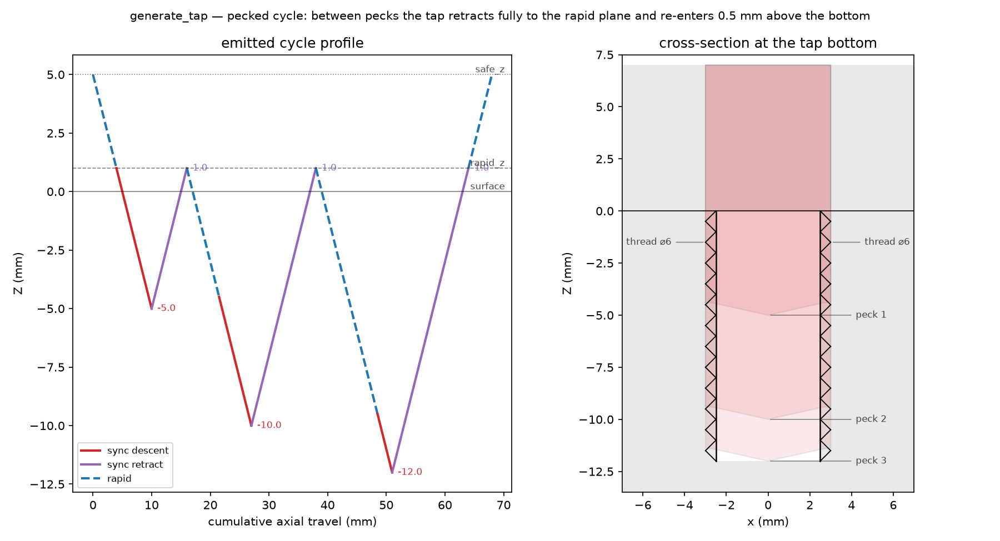

## TapSpec

Parameters for the `tap` assembler: one rigid-tapping cycle.

### `center`

```python
center: tuple[float, float]
```

### `dwell_ms`

```python
dwell_ms: float
```

Dwell at the bottom before the spindle reversal (ms).

### `handedness`

```python
handedness: str
```

`"RH"` or `"LH"`.

### `nominal_diameter`

```python
nominal_diameter: float
```

Nominal (major) diameter of the thread (mm).

### `peck`

```python
peck: Optional[float]
```

Peck increment (mm); `None` taps in a single pass.

### `pitch`

```python
pitch: float
```

Thread pitch (lead): axial travel per spindle revolution (mm).

### `rapid_z`

```python
rapid_z: float
```

Rapid plane just above the surface.

### `safe_z`

```python
safe_z: float
```

### `target_z`

```python
target_z: float
```

Depth of the thread.

### `z_surface`

```python
z_surface: float
```

Surface Z the hole starts at.

## Functions

### `generate_tap()`

```python
generate_tap(
    part: ops.part.Part,
    center: tuple[float, float],
    nominal_diameter: float,
    pitch: float,
    target_z: float,
    z_surface: float = 0,
    rapid_z: float = 1,
    safe_z: float = 5,
    handedness: str = 'RH',
    peck: float | None = None,
    dwell_ms: float = 0,
    state: ops.state.State | None = None,
) -> ops.assembly.AssemblyResult
```

Generate one rigid-tapping cycle.

The tap rapids to the pilot bore (assumed pre-drilled to the tap drill diameter) and descends with
the spindle synchronized to the Z feed — the moves travel `pitch` mm per spindle revolution, i.e. at
`pitch * rpm` mm/min, so `state` must set `spindle_rpm`. At the bottom the spindle reverses and the
synchronized retract unscrews the tap. A right-hand thread taps clockwise (G84), a left-hand thread
counter-clockwise (G74).

| Parameter          | Type                                 | Description                                                                                   |
| ------------------ | ------------------------------------ | --------------------------------------------------------------------------------------------- |
| `part`             | `ops.part.Part`                      | part owning the face the cycle is assembled on.                                               |
| `center`           | `tuple[float, float]`                | `(x, y)` of the pilot bore.                                                                   |
| `nominal_diameter` | `float`                              | nominal (major) thread diameter (mm).                                                         |
| `pitch`            | `float`                              | thread pitch (lead) (mm).                                                                     |
| `target_z`         | `float`                              | depth of the thread.                                                                          |
| `z_surface`        | `float = 0`                          | surface Z the hole starts at (default 0).                                                     |
| `rapid_z`          | `float = 1`                          | rapid plane above the surface (default 1).                                                    |
| `safe_z`           | `float = 5`                          | safe rapid height (default 5).                                                                |
| `handedness`       | `str = 'RH'`                         | `"RH"` (default) or `"LH"`.                                                                   |
| `peck`             | `float &#124; None = None`           | optional peck increment; full synchronized retract to `rapid_z` between pecks (default None). |
| `dwell_ms`         | `float = 0`                          | dwell at the bottom before the reversal (default 0).                                          |
| `state`            | `ops.state.State &#124; None = None` | optional machine state; `spindle_rpm` is required for the synchronization.                    |
| _Returns_          | `ops.assembly.AssemblyResult`        | An **AssemblyResult** with the cycle's moves.                                                 |



*Plain rigid cycle: synchronized profile and thread cross-section; reversal at the bottom.*



*Pecked cycle: full synchronized retracts between pecks clear the flutes.*
