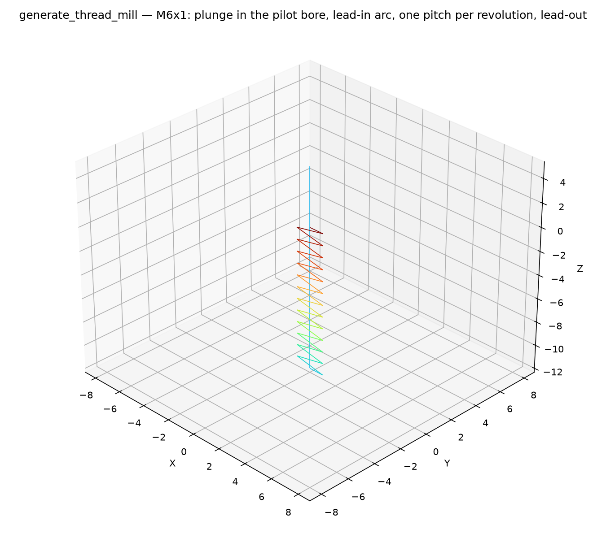

## ThreadMillSpec

Parameters for the `thread_mill` assembler: one internal thread.

### `center`

```python
center: tuple[float, float]
```

### `handedness`

```python
handedness: str
```

`"RH"` or `"LH"`.

### `nominal_diameter`

```python
nominal_diameter: float
```

Nominal (major) diameter of the thread (mm).

### `pitch`

```python
pitch: float
```

Thread pitch (lead): axial travel per revolution (mm).

### `safe_z`

```python
safe_z: float
```

### `tool_diameter`

```python
tool_diameter: float
```

Diameter of the thread mill cutter (mm).

### `z_bottom`

```python
z_bottom: float
```

Z of the bottom end of the thread.

### `z_top`

```python
z_top: float
```

Z of the top end of the thread (milling runs bottom-up).

## Functions

### `generate_thread_mill()`

```python
generate_thread_mill(
    part: ops.part.Part,
    center: tuple[float, float],
    nominal_diameter: float,
    pitch: float,
    tool_diameter: float,
    z_top: float,
    z_bottom: float,
    handedness: str = 'RH',
    safe_z: float = 5,
    state: ops.state.State | None = None,
) -> ops.assembly.AssemblyResult
```

Generate one internal thread-milling cycle.

The tool plunges at the bore center to `z_bottom` (the pilot bore is assumed pre-drilled), swings
out on a 180° tangential lead-in arc to the orbit radius, climbs the thread as a helical
interpolation (one pitch per revolution), and swings back to the center on a lead-out arc. The
thread length must be an integer multiple of the pitch. A right-hand thread climbs
counter-clockwise, a left-hand thread clockwise.

| Parameter          | Type                                 | Description                                       |
| ------------------ | ------------------------------------ | ------------------------------------------------- |
| `part`             | `ops.part.Part`                      | part owning the face the cycle is assembled on.   |
| `center`           | `tuple[float, float]`                | `(x, y)` of the bore.                             |
| `nominal_diameter` | `float`                              | nominal (major) thread diameter (mm).             |
| `pitch`            | `float`                              | thread pitch (lead) (mm).                         |
| `tool_diameter`    | `float`                              | thread mill cutter diameter (mm).                 |
| `z_top`            | `float`                              | Z of the top end of the thread.                   |
| `z_bottom`         | `float`                              | Z of the bottom end of the thread.                |
| `handedness`       | `str = 'RH'`                         | `"RH"` (default) or `"LH"`.                       |
| `safe_z`           | `float = 5`                          | safe rapid height (default 5).                    |
| `state`            | `ops.state.State &#124; None = None` | optional machine state (feeds, spindle, coolant). |
| _Returns_          | `ops.assembly.AssemblyResult`        | An **AssemblyResult** with the cycle's moves.     |



*Thread-milling cycle: tangential lead-in, helical interpolation at one pitch per revolution.*
